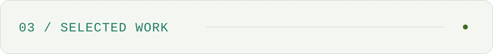

<picture>
  <source media="(prefers-color-scheme: dark)" srcset="./assets/crescent-dark.svg">
  
</picture>

<picture>
  <source media="(prefers-color-scheme: dark)" srcset="./assets/sections/intro-dark.svg">
  
</picture>

<a href="https://oorr.ai">
<picture>
  <source media="(prefers-color-scheme: dark)" srcset="./assets/sections/oorr-dark.svg">
  
</picture>
</a>

<picture>
  <source media="(prefers-color-scheme: dark)" srcset="./assets/sections/work-dark.svg">
  
</picture>

<a href="https://radiant-iraq.com">
<picture>
  <source media="(prefers-color-scheme: dark)" srcset="./assets/sections/radiant-dark.svg">
  
</picture>
</a>

<a href="https://github.com/HelalMajeed/freezone-website">
<picture>
  <source media="(prefers-color-scheme: dark)" srcset="./assets/sections/freezone-dark.svg">
  
</picture>
</a>

<a href="https://github.com/HelalMajeed/Datastructure_Implementations">
<picture>
  <source media="(prefers-color-scheme: dark)" srcset="./assets/sections/structures-dark.svg">
  
</picture>
</a>

<a href="https://github.com/HelalMajeed/Projects4Fun">
<picture>
  <source media="(prefers-color-scheme: dark)" srcset="./assets/sections/experiments-dark.svg">
  
</picture>
</a>

<picture>
  <source media="(prefers-color-scheme: dark)" srcset="./assets/sections/toolkit-dark.svg">
  
</picture>

<picture>
  <source media="(prefers-color-scheme: dark)" srcset="./assets/sections/exploring-dark.svg">
  
</picture>

<a href="https://www.linkedin.com/in/helal-majeed-528901239/">
<picture>
  <source media="(prefers-color-scheme: dark)" srcset="./assets/sections/connect-dark.svg">
  
</picture>
</a>

<strong>About, project links &amp; text version</strong>

I build AI products and the software around them — from interfaces and APIs to the systems that keep them running.

My focus is **useful intelligence**: helping people learn, making complex tools approachable, and turning ideas into working products.

## Currently building

### OORR AI · Learning through conversation

An Arabic-first AI learning platform for Iraqi students. I'm working on textbook retrieval, step-by-step explanations, voice interaction, and a connected study experience across web and mobile.

**The goal:** give students room to ask, explore, practise, and understand at their own pace.

[`Explore OORR AI ↗`](https://oorr.ai) &nbsp; [`API documentation ↗`](https://radiant-iraq.com/docs/oorr/)

## Selected work

<table>
<tr>
<td width="50%" valign="top">

### 01 / Radiant

A home for AI products, experiments, and developer tools.

**AI · Web · Developer experience**

[Website ↗](https://radiant-iraq.com)

</td>
<td width="50%" valign="top">

### 02 / FREEZONE

Commerce software connecting a storefront, management dashboard, and backend API.

**TypeScript · React · Node.js · PostgreSQL**

[Repository ↗](https://github.com/HelalMajeed/freezone-website)

</td>
</tr>
<tr>
<td width="50%" valign="top">

### 03 / Data structures

Implementations in C and C++ — working through the foundations behind the software.

**C · C++ · Algorithms**

[Explore the code ↗](https://github.com/HelalMajeed/Datastructure_Implementations)

</td>
<td width="50%" valign="top">

### 04 / Projects for fun

A collection of web, desktop, and terminal experiments. A place to build and learn by doing.

**Experiments · Applications · Games**

[Explore the collection ↗](https://github.com/HelalMajeed/Projects4Fun)

</td>
</tr>
</table>

## Toolkit

| Area | Working with |
| :--- | :--- |
| **AI systems** | Retrieval-augmented generation · LLM integration · Conversational interfaces |
| **Product engineering** | TypeScript · JavaScript · React · Next.js · Node.js · Python |
| **Data & delivery** | PostgreSQL · Prisma · Docker · Linux · Git |
| **Foundations** | C · C++ · Data structures · Algorithms |

## What I'm exploring

**Agentic tutoring** that connects explanation, practice, and feedback. **Voice interfaces** that feel natural to use. **Retrieval and evaluation** that make AI answers more dependable.

## Connect

Interested in AI, education, or building useful software? Find my work through [Radiant](https://radiant-iraq.com), [OORR AI](https://oorr.ai), or [my public repositories](https://github.com/HelalMajeed?tab=repositories).

[Connect on LinkedIn](https://www.linkedin.com/in/helal-majeed-528901239/)

<picture>
  <source media="(prefers-color-scheme: dark)" srcset="./assets/divider-dark.svg">
  
</picture>

