# Artwork preview

Actual GitHub image rendering at a 360-pixel width. Both themes are shown directly, independent of the selected GitHub theme.

## intro

 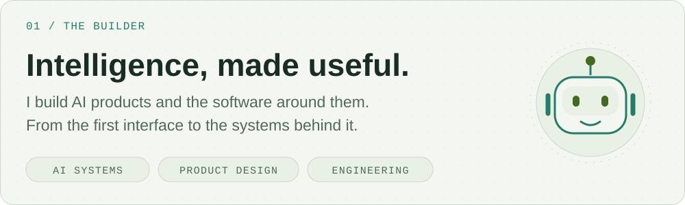

## oorr

 

## radiant

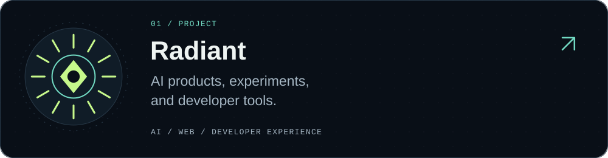 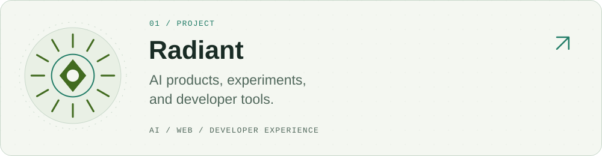

## freezone

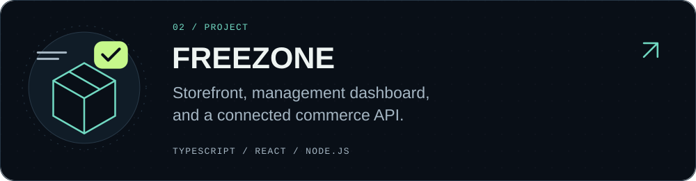 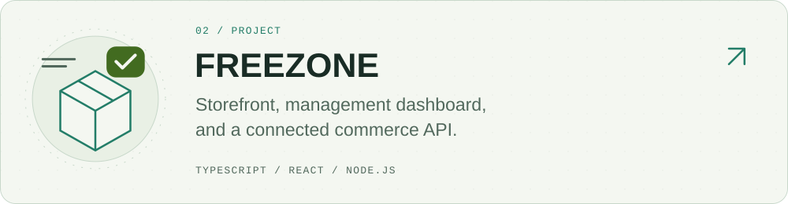

## structures

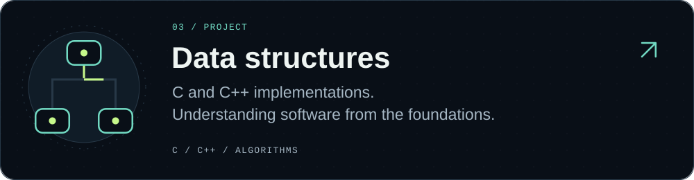 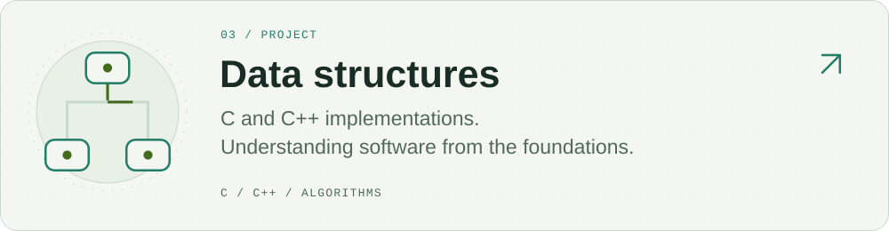

## experiments

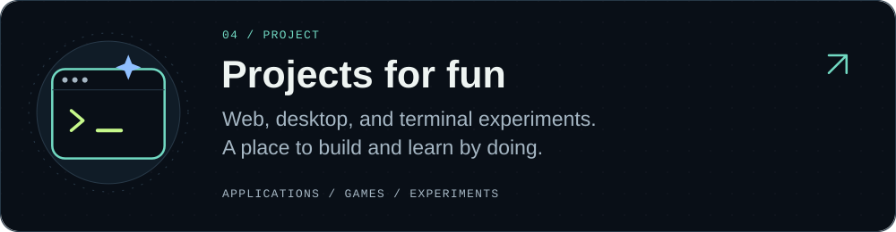 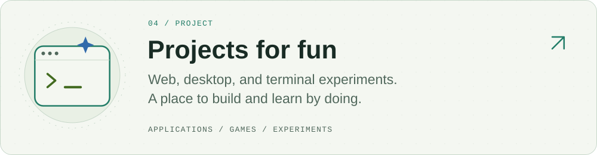

## toolkit

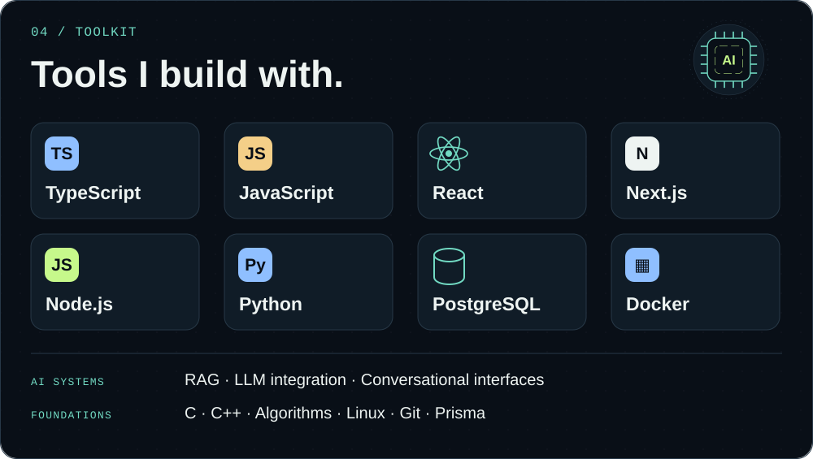 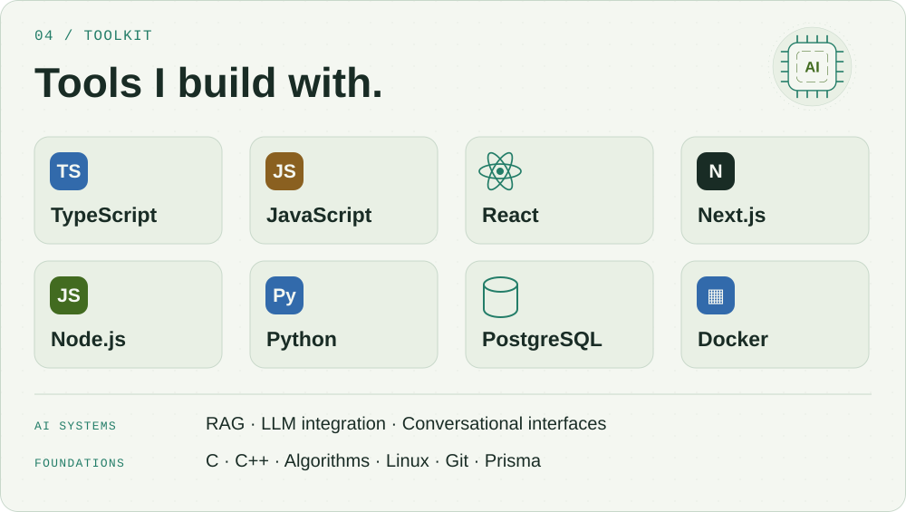

## exploring

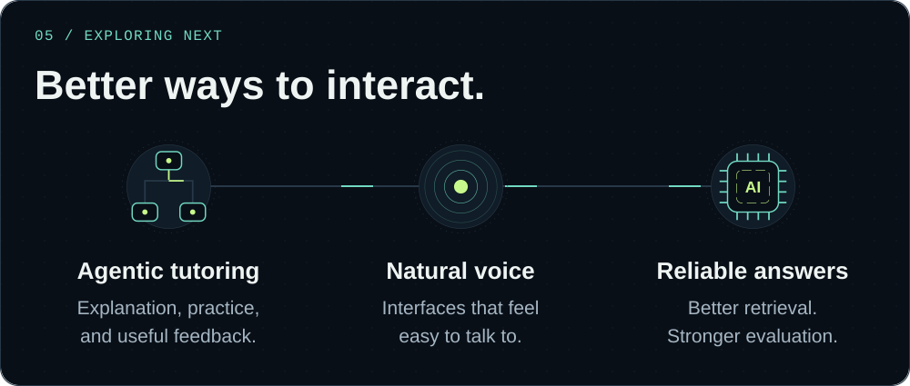 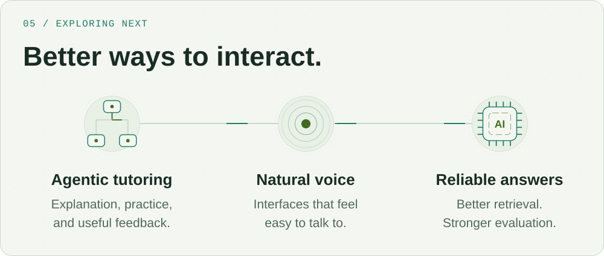

## connect

 

